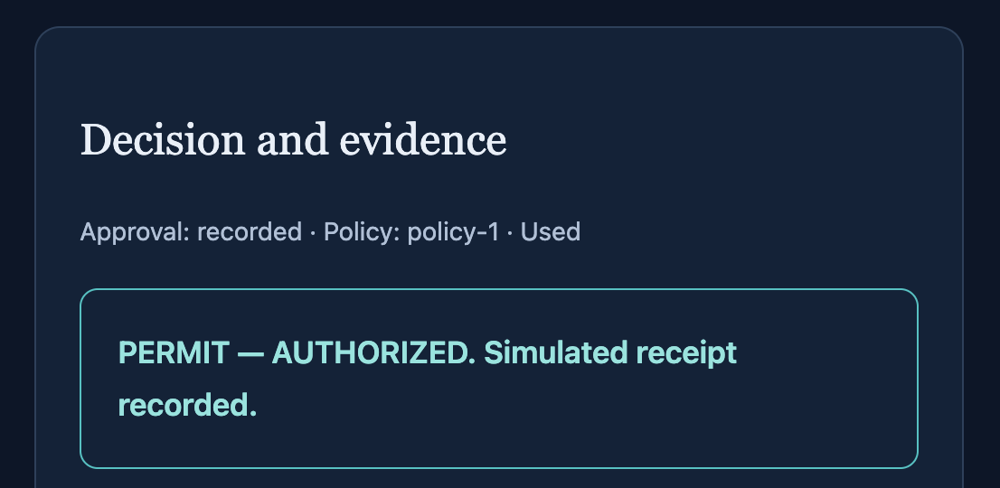
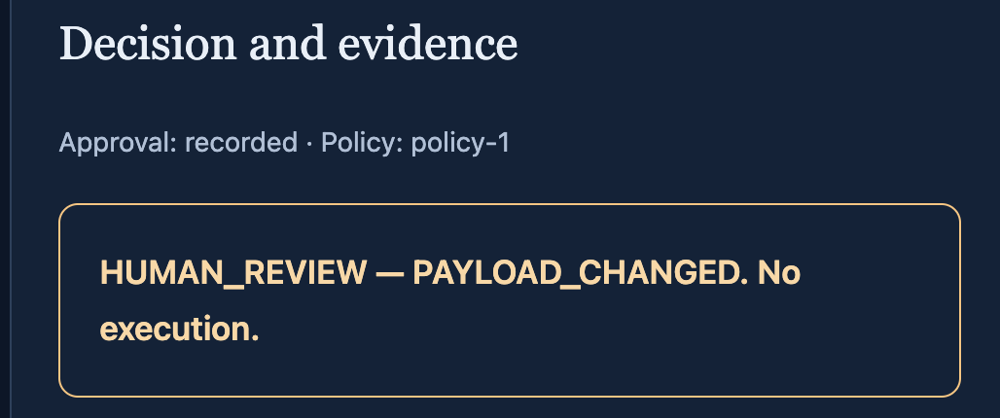
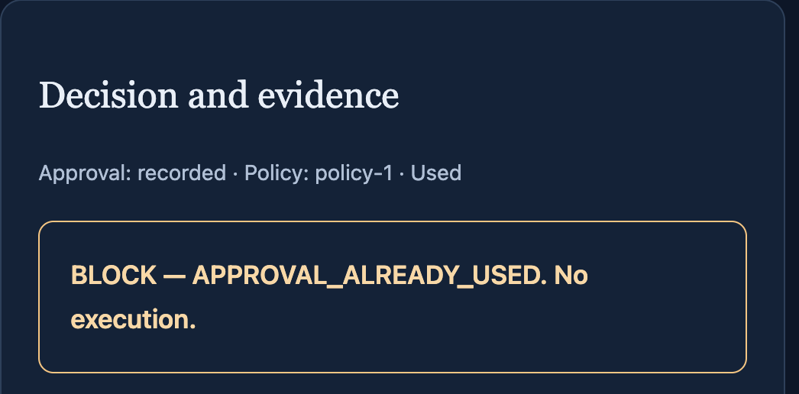
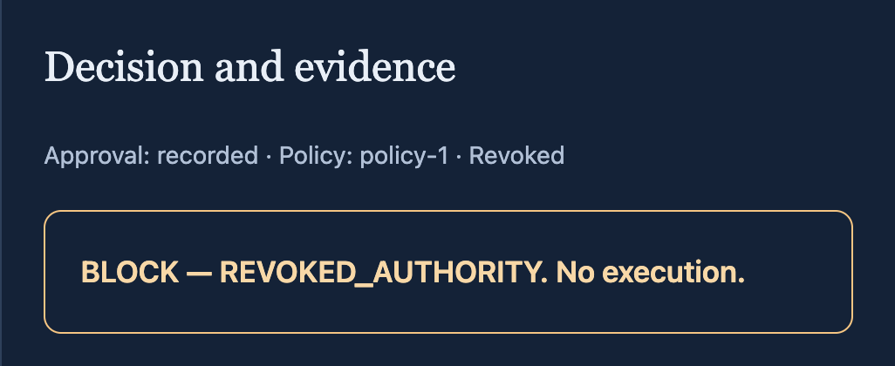
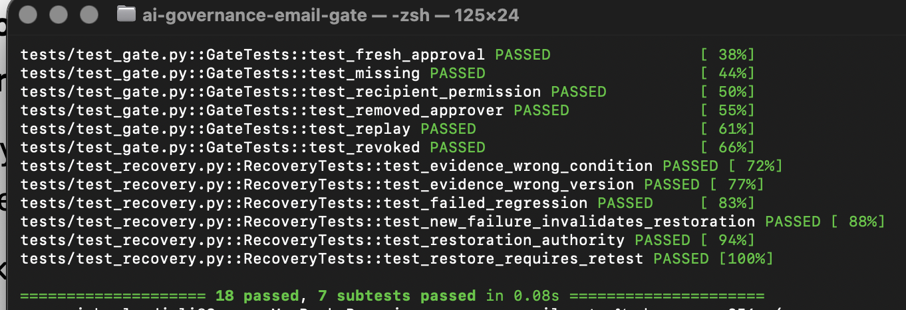
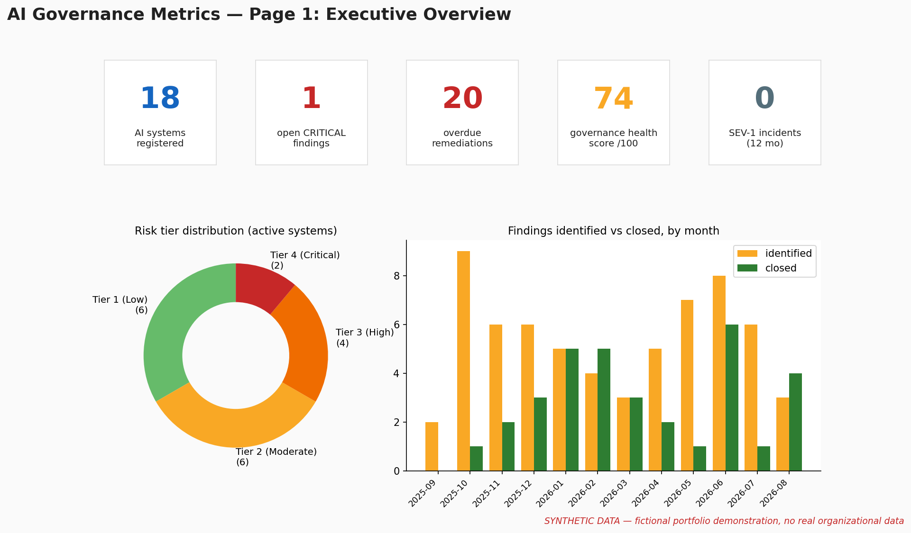
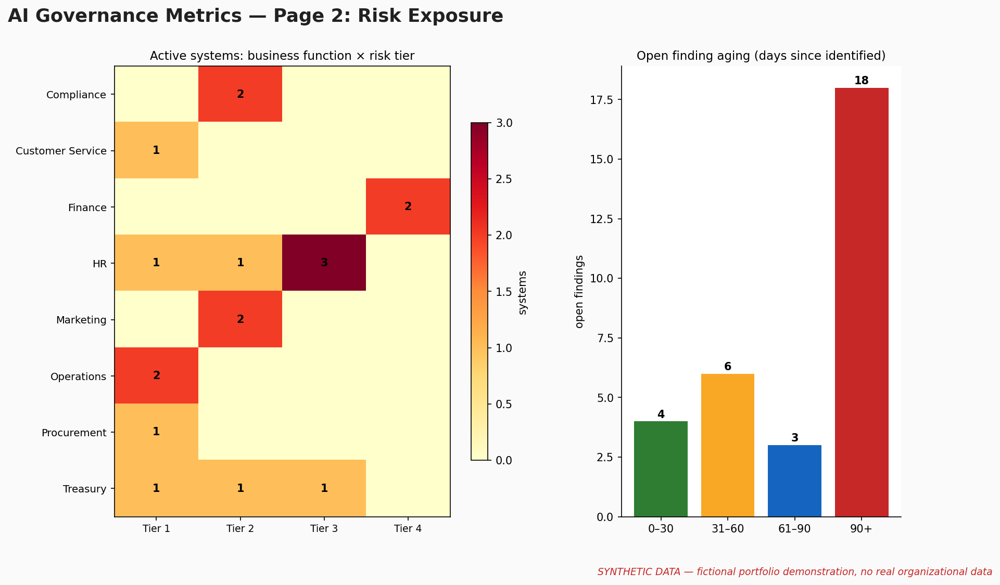
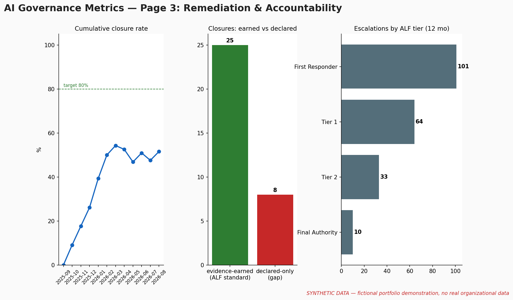
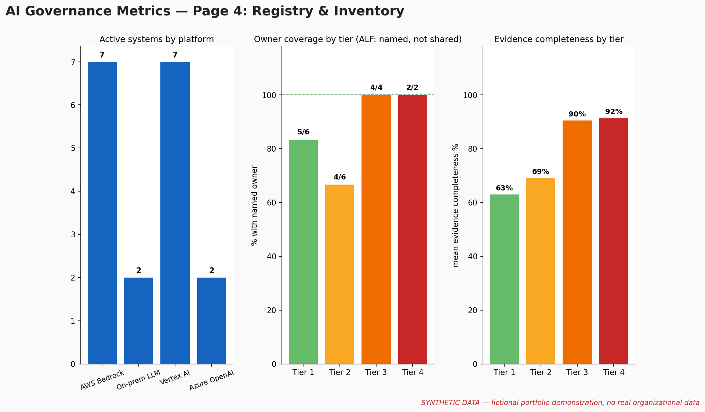

# Grace Adjeli | AI Governance Career Portfolio

**AI Governance • Responsible AI • AI Risk & Controls • AI Security • Governance Program Implementation**

**AIGP | CISSP | PMP | PMI-ACP | SSCP**

> Governance is not what is defined. It is what is enforced at execution.

I am an AI governance and enterprise technology practitioner with more than 10 years of experience across cybersecurity, cloud/DevOps, risk and control activities, Agile delivery, and regulated technology environments. My experience includes the Federal Reserve, Ascensus, Red River, the Department of Veterans Affairs, and DC Health Benefit Exchange.

I founded **BridgeCore AI** to research, design, implement, and test practical AI governance approaches. This portfolio connects my professional experience to selected practitioner work. It includes risk assessments and operating workflows as well as technical controls. My synthetic examples are **not represented as production client deployments**.

[LinkedIn](https://www.linkedin.com/in/graceadjeli/) · [BridgeCore AI](https://bridgecore-ai.com/) · [Substack](https://graceadjeli.substack.com/)  · gracemichaels.adjeli@gmail.com

## Start here — selected work

| Project | Governance question | Public evidence and scope |
| --- | --- | --- |
| [Email Authorization Gate](https://bridgecore-ai.com/ai-governance-email-gate.html) | Does prior approval still authorize an action if its payload, policy, or authority changes? | Browser illustration, Python test evidence, manifest and integrity hash; synthetic, single-process demonstrator |
| [Governance at Execution — Case Study 01](https://bridgecore-ai.com/governance-at-execution-case-study-01.html) | What happens when conditions change between approval and execution? | Scenario analysis and MVAC model; analytical reference work |
| [LLM Export-Control Gate](https://github.com/BridgeCoreAI/llm-export-control-gate) | How can classification and endpoint restrictions be evaluated before model access? | Reference implementation; not certified export-control compliance |
| [GAEX](https://github.com/BridgeCoreAI/gaex) | How can action admissibility depend on current context? | Public implementation and technical repository; scope defined in repo |
| [HITL Under Load](https://github.com/BridgeCoreAI/hitl-under-load) | Where does human-in-the-loop oversight silently degrade under load? | Discrete-event simulator; reproducibility suite re-verifies every published finding on each push; public CI |
| [AI GRC Engineering](https://github.com/BridgeCoreAI/ai-grc-engineering) | Can documentation claims about a framework be machine-enforced? | 26-module portfolio (NIST AI RMF, ISO/IEC 42001, EU AI Act); "26 modules complete" verified by structural integrity CI |
| AI Governance Risk Assessment Practitioner Lab | How do intake, assessment, control evaluation, decisions and monitoring connect? | Structured synthetic practitioner artifacts; detailed private materials are not claimed as publicly verifiable |

## Relevant career capabilities

| AI Governance role family | Relevant capabilities and evidence |
| --- | --- |
| **AI Governance Analyst / Program Operations** | AI use-case intake, assessment workflows, registries and inventories, review packets, decision registers, routing and notification patterns, tracking, monitoring, executive reporting, cross-functional coordination |
| **AI Risk & Controls** | Risk classification, control mapping, evidence evaluation, findings, remediation tracking, residual-risk analysis and reassessment |
| **Responsible AI / AI Assurance** | Human oversight, authorization boundaries, assurance claims, evidence sufficiency, corrective action and bounded restoration |
| **AI Security / AI GRC** | Security control assessment, sensitive-data controls, least-privilege approaches, execution gates, security and audit evidence |
| **Third-Party AI Risk** | Vendor-related evidence freshness, context change, reassessment triggers, accountability and escalation models |
| **AI Transformation & Enablement** | Regulated enterprise program delivery, responsible adoption guidance, Agile leadership, dashboards and continuous improvement |

## Featured evidence: Email Authorization Gate

This synthetic practitioner demonstrator examines whether governance rules hold **when an action is attempted**, not merely when approval is granted. In the browser illustration, a changed recipient triggers human review; an unchanged approved draft can be permitted; consumed or revoked approval is blocked.

The Python implementation has recorded evidence tied to commit `7350b913121af37b51eaf8d576beab71d256aa57`, GitHub Actions run `38030602167`, attempt 1 (Python 3.12.15). The published evidence SHA-256 is:

`fc465a2a3f9121c1bda61d70d0ea10b01e49af863306ff48a67b663ffbcb8acd`

The locally reproduced test summary was **18 passed, 7 subtests passed**. A matching SHA-256 verifies file integrity against the published reference; it does not prove production effectiveness or independent assurance.

### Hands-on public browser validation (October 2026)

I performed a guided, manual check of the **public browser illustration** after the evidence-download configuration was updated. This is a separate validation activity from the recorded Python CI suite.

| Browser scenario | Observed decision or evidence | Status |
| --- | --- | --- |
| Approve original synthetic draft | `Approval: recorded`; fresh approval associated with the exact draft | Observed as expected |
| Change recipient after approval | `HUMAN_REVIEW — PAYLOAD_CHANGED`; no simulated execution | Observed as expected |
| Execute unchanged approved draft | `PERMIT — AUTHORIZED`; simulated receipt recorded | Observed as expected |
| Attempt to reuse consumed approval | `BLOCK — APPROVAL_ALREADY_USED`; no execution | Observed as expected |
| Revoke approval before execution | `BLOCK — REVOKED_AUTHORITY`; no execution | Observed as expected |
| Expired approval | Not yet manually validated in this review | Pending |
| Policy change after approval | Not yet manually validated in this review | Pending |

**Evidence retrieval and traceability check:** Both public JSON links downloaded successfully and opened as readable text. The locally calculated SHA-256 of the recorded Python evidence **exactly matched** the published value above. The downloaded manifest identified repository `BridgeCoreAI/ai-governance-email-gate`, tested commit `7350b913121af37b51eaf8d576beab71d256aa57`, workflow run `38030602167`, attempt `1`, and the same evidence hash. The browser's built-in JSON viewer showed an error when opening the file, but the downloaded file opened with TextEdit; the file download itself was successful.

**What this establishes:** These checks corroborate selected browser-demonstrator paths and the downloaded evidence file's integrity relative to the published hash. They do **not** independently authenticate the CI run, cover every Python test through the browser, demonstrate real email delivery, or constitute production assurance. The browser example operates locally within a visitor's session.

[Examine the case study, browser illustration, and evidence downloads](https://bridgecore-ai.com/ai-governance-email-gate.html)

### Email Authorization Gate — Visual Evidence

These screenshots document observed results from the synthetic browser illustration. The Python test screenshot is separate local test evidence, not production assurance.

| Authorized execution | Changed payload |
| --- | --- |
|  |  |
| **PERMIT — AUTHORIZED**; simulated receipt recorded. | **HUMAN_REVIEW — PAYLOAD_CHANGED**; no execution. |

| Approval replay | Revoked authority |
| --- | --- |
|  |  |
| **BLOCK — APPROVAL_ALREADY_USED**; no execution. | **BLOCK — REVOKED_AUTHORITY**; no execution. |

**Separate local Python test results**

The screenshot shows a locally reproduced test run. The recorded CI evidence and integrity manifest are linked in the case study above. These demonstrations do not establish independent or production assurance.

## Other governance and assurance work

**Governance at Execution™ and GAEX:** Explore the distinction between design-time approval and whether a particular action remains permissible under current conditions. The MVAC context model captures Principal, Action, Object, Target, Current State and Authorization Context. [Case study](https://bridgecore-ai.com/governance-at-execution-case-study-01.html) · [GAEX technical repository](https://github.com/BridgeCoreAI/gaex)

**LLM Export-Control Gate:** Explore classification-aware request admissibility, endpoint constraints, prompt-injection and exfiltration screening, permit/block/human-review routing, and evidence capture; 55 adversarial and conformance tests run in public CI. [Technical repository](https://github.com/BridgeCoreAI/llm-export-control-gate)

**AI risk assessment and governance operations:** Develop synthetic workflows for use-case intake, risk tiering, evidence collection, decision ownership, exceptions, findings, treatment actions and review. Detailed private artifacts may be discussed separately; descriptions are not presented as public verification.

**Corrective action and assurance restoration:** Examine the chain from control failure to invalidated claim, correction, same-condition or equivalent-condition retest, regressions, named review and bounded restoration. A successful rerun alone does not reestablish every prior assurance claim.

**Data governance:** Address data classification, provenance, lineage, access, retention, ownership and changing authorization context as underlying AI governance concerns.

## Governance metrics dashboard (synthetic)

These illustrations use reproducible fictional data, not live employer or client performance information.

| Executive overview | Risk exposure |
| --- | --- |
|  |  |

| Remediation and accountability | Registry and inventory |
| --- | --- |
|  |  |

[Additional synthetic evidence-engine illustration](https://bridgecore-ai.com/evidence-engine-demo.html)

## Professional experience

- **BridgeCore AI — Founder | AI Governance Researcher & Practitioner (Apr 2023–present):** Independent AI governance assessments, reference implementations, evidence methods and practitioner publications.
- **Red River Technology — Scrum Master | Team Coach / Deputy Release Train Engineer (Dec 2024–Jul 2026):** Cross-functional technology governance support, control evidence and remediation coordination, Responsible AI/security-related requirements, program reporting and stakeholder alignment.
- **Ascensus — Senior Scrum Master (Oct 2023–Oct 2024):** Regulated financial-services delivery; selected for an internal initiative supporting responsible AI adoption by Scrum Masters and Product Owners.
- **Federal Reserve Bank — Scrum Master | Team Coach (Sep 2021–Jul 2023):** Multi-team regulated technology delivery, Tableau reporting and coaching.
- **Earlier experience (2016–2021):** JP Associates, Department of Veterans Affairs and DC Health Benefit Exchange: Scrum, DevOps, AWS/cloud engineering, security and release practices.

**Certifications:** AIGP, CISSP, SSCP, PMP, PMI-ACP; additional Scrum, Agile coaching and SAFe credentials.

**Research:** Doctoral research at Capitol Technology University on *Ethical Frameworks for Human-AI Collaboration in Cybersecurity Decision-Making*. This description does not claim an awarded doctorate.

**Frameworks:** NIST AI RMF; ISO/IEC 42001; ISO/IEC 23894; EU AI Act concepts; NIST CSF; cybersecurity, privacy and data governance.

## Evidence boundaries

- Independent BridgeCore AI practitioner projects are distinguished from employer experience; no synthetic example is claimed as client production deployment.
- Public demos use fictional data, and code, tests and scope limitations must be read together.
- A successful automated test or matching evidence checksum supports a specific assertion, **not blanket production assurance**.
- References to private work are descriptive and not substitutes for independently inspectable evidence.
- No confidential employer or client information is included.

## Professional interests

I am pursuing roles across **AI Governance, Responsible AI, AI Risk & Controls, AI GRC, AI Assurance, Third-Party AI Risk and AI Governance Program Implementation**.

[Connect on LinkedIn](https://www.linkedin.com/in/graceadjeli/) · [Read my writing](https://graceadjeli.substack.com/) · [Explore BridgeCore AI](https://bridgecore-ai.com/)

---

*Governance is not what is defined. It is what is enforced at execution.* — **Grace Adjeli**
